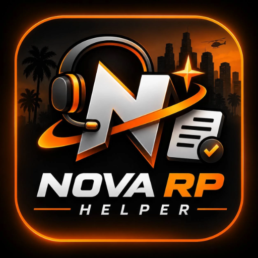
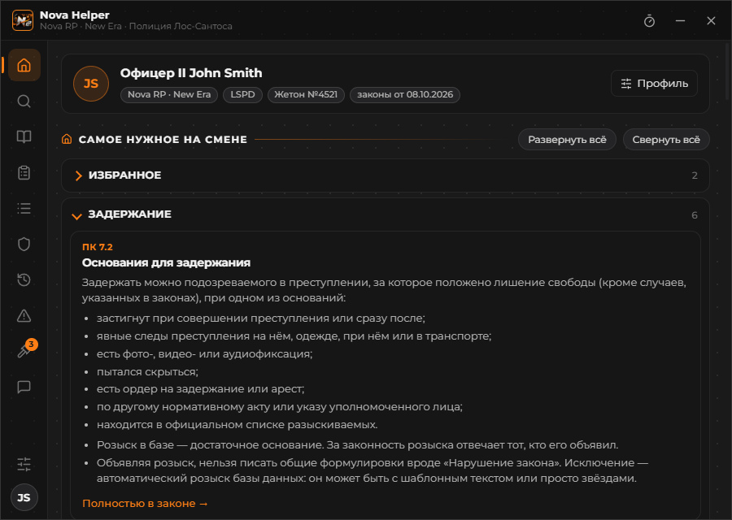
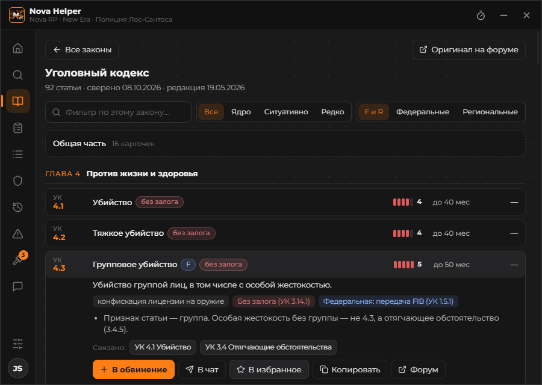
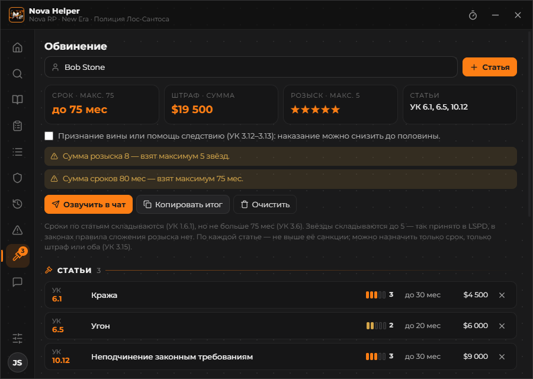
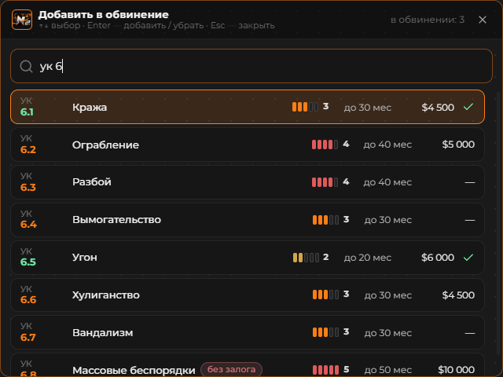
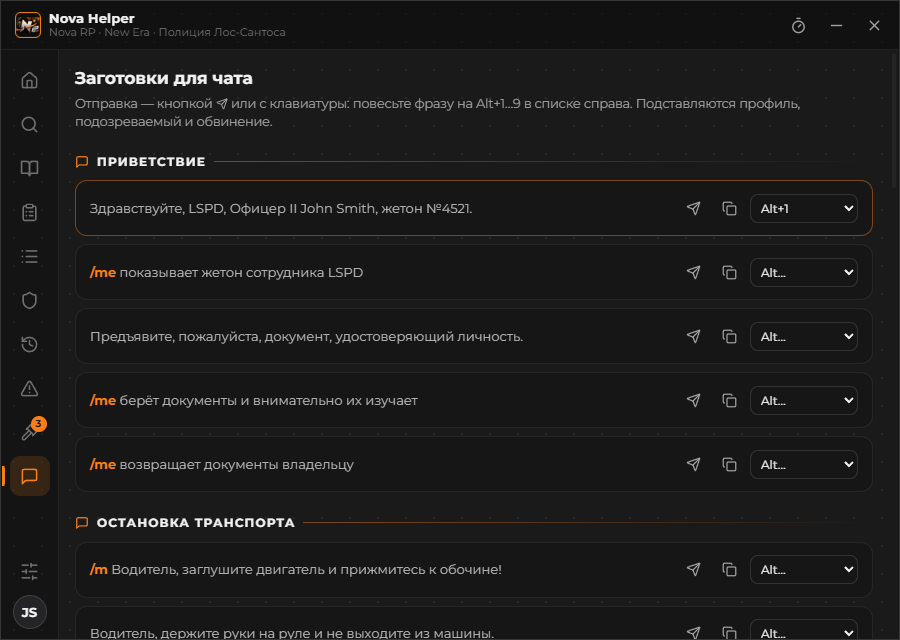

  

<h1 align="center">Nova Helper</h1>

  Офлайн-помощник офицера LSPD для <b>Nova RP · New Era</b>: памятка по законам, обвинение со сроком и штрафом, 
  заготовки для чата — в окне поверх игры, с отправкой фраз в игровой чат по горячим клавишам.

  
  
  
  

  <a href="https://github.com/Unandoriz/nova-helper/releases/latest"><b>⬇ Скачать установщик</b></a>

---

## Что умеет

- **Памятка LSPD целиком** — все разделы [памятки офицера](https://lspd-nova.gitverse.site/lspd/): главная по ситуациям, все 34 закона с главами и фильтрами, шпаргалка, порядок действий, защита офицера, поправки и нестыковки. Внутри программы, без интернета.
- **Поиск** по номеру (`6.5`, `дк 3.3`, `ук 10.12`) и словам, с подсветкой. `Ctrl+F` — из любого раздела.
- **Обвинение** — набрали статьи, программа сложила срок (не больше 75 мес), розыск (до 5 звёзд) и штрафы, предупредила о федеральных статьях, «без залога» и лимите штрафа, учла признание вины. Рапорт, протокол, запрос ордера и розыск — с подстановкой имени, жетона и статей.
- **Окно поверх игры.** Плашка, не мешающая играть, разворачивается по `Ctrl+Shift+H`. Прозрачность, размер текста, режим «показывать только когда игра впереди».
- **Статья прямо из игры.** `Ctrl+Shift+G` — найти и добавить в обвинение, `Ctrl+Shift+F` — сказать нарушителю «Вы нарушили статью…» в чат. Не выходя из игры.
- **Заготовки для чата** — приветствие, задержание, права, обыск, рация (`/me`, `/do`, `/r`) и свои фразы. Любую можно повесить на `Alt+1…9`.
- **Таймер задержания** на `Ctrl+Shift+T` — с предупреждением за минуту и сигналом по окончании.
- **Обновления** — свежая памятка с сайта и новые версии программы из релизов GitHub, в один клик. Без интернета всё работает на встроенной копии.

| Закон с главами и фильтрами | Обвинение |
|---|---|
|  |  |
| **Выбор статьи поверх игры** | **Заготовки на Alt+цифра** |
|  |  |

## Установка

1. Скачайте `NovaHelper-Setup-<версия>.exe` со страницы [релизов](https://github.com/Unandoriz/nova-helper/releases/latest).
2. Запустите. Windows может показать «Система Windows защитила ваш компьютер»: установщик не подписан платным сертификатом — нажмите **Подробнее → Выполнить в любом случае**.
3. В игре включите режим экрана **«Оконный без рамки»** — поверх полноэкранной игры Windows ничего не показывает.
4. В программе: **Настройки → Профиль** — имя, звание, жетон (подставляются в фразы и документы).

## Горячие клавиши

| Сочетание | Действие |
|---|---|
| `Ctrl+Shift+H` | показать / свернуть в плашку |
| `Ctrl+Shift+G` | найти статью и добавить в обвинение |
| `Ctrl+Shift+F` | найти статью и сказать нарушителю в чат |
| `Ctrl+Shift+T` | таймер задержания: запустить / остановить |
| `Alt+1…9` | отправить заготовку, назначенную на цифру |
| `Ctrl+F` | поиск (в окне программы) |

Все сочетания меняются в настройках — если мешают биндам сервера, переназначьте или выключите.

## Как фраза попадает в чат

Программа находит окно игры (клиент RAGE Multiplayer / GTA 5), выводит его вперёд и делает то же, что игрок руками: **клавиша чата → `Ctrl+V` → `Enter`**. Фраза кладётся в буфер обмена, длинный текст (например, права задержанного) уходит несколькими строками. В процесс игры программа не вмешивается и память не читает. В браузеры, мессенджеры и лаунчеры фраза не уйдёт никогда.

Если игра не нашлась — программа скажет об этом, а фраза останется в буфере: вставьте её сами.

## Источник памятки

Тексты памятки — [«Памятка LSPD»](https://lspd-nova.gitverse.site/lspd/) автора **Salva Cnaps** (LSPD, Nova RP). Nova Helper показывает её внутри программы, без изменений, со ссылками на оригинал и форум. Памятка неофициальная: в спорных случаях решает текст законов на [форуме](https://forum.grand-rp.su/forums/1320/). Если вы автор памятки и против её использования здесь — напишите в [Issues](https://github.com/Unandoriz/nova-helper/issues).

Проект не связан с администрацией Nova RP / Grand RP и Rockstar Games.

## Лицензия

Nova Helper бесплатен, лицензия [MIT](LICENSE). Тексты памятки принадлежат их автору; шрифт Montserrat — SIL OFL, иконки интерфейса — [Lucide](https://lucide.dev) (ISC). Подробно — [NOTICE](NOTICE).
